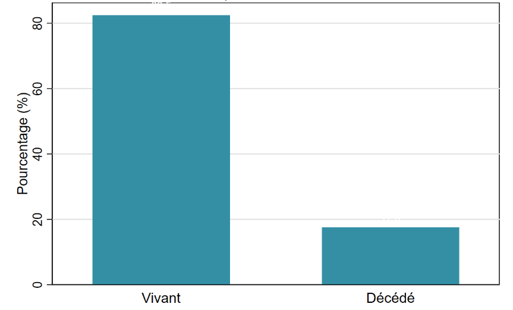
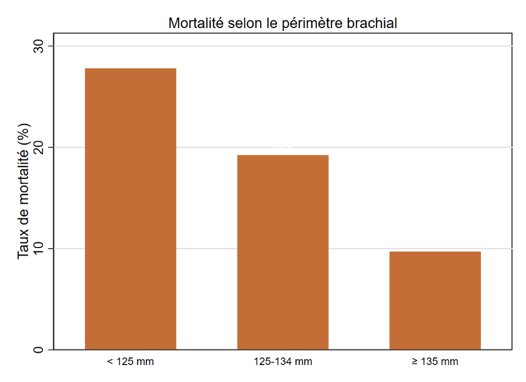
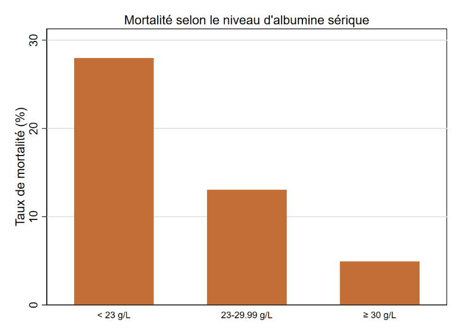
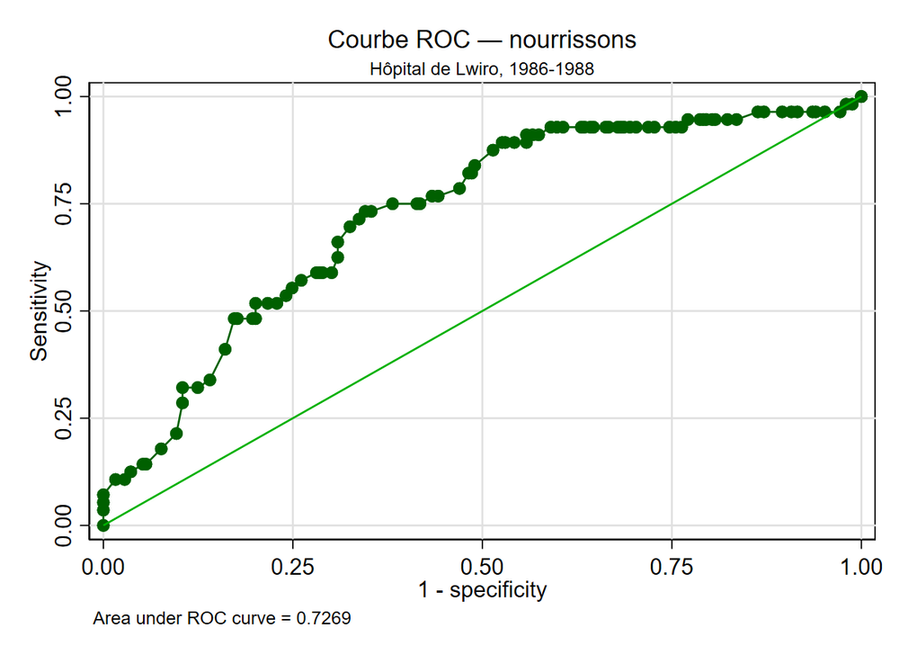

# Étude de la mortalité des enfants hospitalisés à Lwiro (1986 à 1988)

Projet de groupe du cours Logiciels statistiques (STATA et SPSS), cycle des Ingénieurs Statisticiens Économistes (ISE 2), ENEAM, année académique 2025-2026.

**Groupe STATA 1 :** onze étudiants, membres internes et consultants (liste complète sur la page de couverture du rapport). **Chef de groupe :** Ariel Angelo Kolawolé HOUNKPATIN.

**Rapport complet :** [Rapport-Mortalite-infantile-Lwiro.pdf](Rapport-Mortalite-infantile-Lwiro.pdf) (56 pages)

## Question

Quelle est l'ampleur de la mortalité intra-hospitalière des enfants admis à l'hôpital de Lwiro (Sud-Kivu, République démocratique du Congo) entre 1986 et 1988, et quels facteurs sont associés au décès chez les nourrissons de moins de 12 mois ?

## Données

Dix fichiers hétérogènes (formats `.dta`, `.xls`, `.xlsx` et `.sav`) sur des enfants hospitalisés, apurés puis fusionnés avec des données sociodémographiques. La base finale compte **1 129 enfants** et 13 variables codées, sans identifiant nominatif.

La base brute et la base apurée ne sont pas republiées dans ce dépôt : elles proviennent de fichiers fournis dans le cadre du cours. Pour rejouer l'analyse, placer `Bas_apuree.dta` dans le dossier de travail et adapter la ligne `global dir` des do-files.

### Apurement

- Harmonisation des noms de variables selon le dictionnaire de données.
- Concaténation des dix bases (1 139 observations), puis suppression de 10 doublons (1 129 enfants).
- Valeurs hors plage du dictionnaire traitées comme manquantes : 2 âges, 1 rang de naissance et 24 valeurs de situation matrimoniale.
- Imputation par la médiane pour les variables quantitatives, par le mode pour les variables dichotomiques peu manquantes, et par tirage aléatoire selon la distribution observée pour les variables très manquantes (niveau d'étude de la mère : 23,5 % ; classification de Waterlow : 10 %). Une graine aléatoire est fixée dans le do-file.
- Recodage en catégories cliniques : périmètre brachial (moins de 125 mm, 125 à 134 mm, 135 mm et plus), albumine sérique (moins de 23, 23 à 29,99, 30 g/L et plus) et rang dans la fratrie.

La variable `durhosp` de la base finale contient en réalité l'albumine sérique : la variable d'origine portant ce nom contenait des valeurs incohérentes et a été remplacée par `alb`.

## Méthode

- Statistique descriptive, avec un intervalle de confiance de Wilson pour la proportion de décès.
- Associations bivariées : khi-deux de Pearson ou test exact de Fisher, V de Cramér, tests t, Mann-Whitney, ANOVA ou Kruskal-Wallis selon le cas.
- Régression logistique avec sélection backward (seuil de sortie de 5 %), restreinte aux nourrissons de 0 à 11 mois.
- Diagnostics : Hosmer-Lemeshow, linktest, matrice de classification et courbe ROC.

Outil : Stata MP 17.

## Résultats principaux

- **Létalité hospitalière globale : 17,5 %** (IC 95 % : 15,4 % à 19,9 %), soit près d'un enfant sur six.
- Sur l'ensemble des 1 129 enfants, 8 prédicteurs sur 15 sont significativement associés à l'issue, les plus fortes associations concernant les œdèmes (V de Cramér = 0,277), l'albumine catégorisée (0,245) et la situation matrimoniale de la mère (0,239).
- **Nourrissons** : 305 enfants dont 56 décès (18,4 %, IC 95 % : 14,4 % à 23,1 %). Leur profil diffère de celui de l'ensemble : très peu d'œdèmes (7,2 % contre 28,9 %) mais davantage de malnutrition aiguë (45,9 % avec un périmètre brachial inférieur à 125 mm, contre 29,9 %).

Modèle logistique final chez les nourrissons (quatre variables retenues) :

| Variable | Odds ratio | IC 95 % | p |
|---|---|---|---|
| Âge, par mois | 0,889 | 0,803 à 0,985 | 0,024 |
| Périmètre brachial 125 à 134 mm (réf. moins de 125) | 0,463 | 0,226 à 0,949 | 0,035 |
| Périmètre brachial 135 mm et plus | 0,192 | 0,065 à 0,573 | 0,003 |
| Albumine 30 g/L et plus (réf. moins de 23) | 0,313 | 0,126 à 0,778 | 0,012 |

Le taux de décès des nourrissons passe de 27,9 % (périmètre brachial inférieur à 125 mm) à 14,0 % puis 5,6 % (135 mm et plus), et de 28,3 % à 19,5 % puis 11,7 % selon le niveau d'albumine.

**Qualité du modèle.** Hosmer-Lemeshow : chi2(8) = 8,40 (p = 0,396). Linktest correct. AUC = 0,727. Pseudo R² de McFadden = 0,10.

Chez les nourrissons, les œdèmes, la diarrhée, le paludisme et la situation matrimoniale ne sont pas retenus dans le modèle, contrairement à l'analyse sur l'ensemble : les facteurs nutritionnels et l'âge dominent, ce qui plaide pour un dépistage nutritionnel précoce différencié selon l'âge.

## Limites

- **Sensibilité très faible.** Avec le seuil de classification par défaut, le modèle n'identifie que 3 des 56 décès (sensibilité de 5,4 %), même si 82,6 % des enfants sont bien classés. Sur un événement rare, l'AUC est un indicateur plus informatif que le taux de bien classés.
- **Peu de décès pour le nombre de variables.** La sélection backward part de 18 termes pour 56 décès, soit environ 3 décès par terme, bien en dessous du repère usuel d'une dizaine. Le risque de surajustement est réel et les odds ratios sont à interpréter avec prudence.
- **Imputation aléatoire.** Elle concerne deux variables très manquantes et peut ajouter du bruit.
- Étude rétrospective, sur un seul hôpital et une période ancienne.

## Contenu du dépôt

| Fichier | Rôle |
|---|---|
| `datacleaning_stata1.do` | Apurement : harmonisation, concaténation, doublons, fusion, imputation, recodage |
| `analyse_stata1.do` | Analyses descriptives, bivariées et modèle logistique |
| `datacleaning_stata1.log`, `analyse_stata1.log` | Journaux d'exécution Stata (chemins personnels remplacés) |
| `Rapport-Mortalite-infantile-Lwiro.pdf` | Rapport complet |
| `figure-*.png` | Figures du rapport |

---
Ariel Angelo Kolawolé HOUNKPATIN, Ingénieur Statisticien Économiste, ENEAM, Université d'Abomey-Calavi
